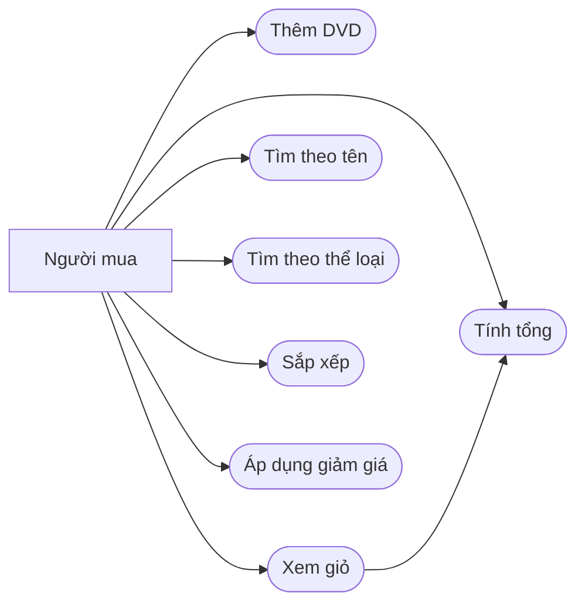

# Use case AIMS-mini

Tác nhân: người mua, tương tác với giỏ và tìm DVD trong danh sách.

- Thêm: chọn DVD, gọi `add_dvd`; giỏ tối đa 20 DVD, DVD thứ 21 bị từ chối (`False`).
- Xem giỏ: `print_cart` in danh sách và tổng tiền, hoặc thông báo giỏ rỗng.
- Tính tổng: cộng `cost` của các DVD trong giỏ.
- Tìm theo tên: `search_by_title` nhận danh sách và từ khóa, trả các DVD có tựa chứa từ khóa, không phân biệt hoa thường.
- Tìm theo thể loại: `search_by_category` khớp chính xác thể loại (phân biệt hoa thường).
- Sắp xếp: `sort_by_title` / `sort_by_cost` trả danh sách mới đã sắp tăng dần.
- Giảm giá: `total_cost_with_discount(percent)` với `percent` trong khoảng [0, 100].
